# Drone Swarm Robotics Simulator

[](https://github.com/guptuv/drone-swarm-robotics/actions/workflows/tests.yml)
[](LICENSE)

A Python simulator for multi-drone swarms covering the core problems of swarm robotics — from classic Boids to multi-agent reinforcement learning, graph neural networks and deep-learning perception:

| Area | What is implemented |
|---|---|
| Collective motion | Boids flocking (separation, alignment, cohesion) |
| Navigation | Goal seeking, static buildings, **moving obstacles** with predictive avoidance |
| Formation control | Circle / V / grid / helix / sphere, Hungarian slot assignment, PD tracking, **fault tolerance** |
| Vehicle model | Point mass **or quadrotor dynamics** (thrust & tilt limits, attitude lag), **wind gusts**, **GPS noise** |
| Networking | **Communication range, packet loss and latency** between drones |
| Multi-swarm | **Several teams sharing the airspace**, reciprocal avoidance with a right-hand rule |
| Search & rescue | PSO with local radio communication vs lawnmower vs random search |
| Coverage | **Voronoi / Lloyd coverage control** with **battery-aware return-to-charge** |
| Distributed control | **Consensus** rendezvous & formation, **leader-follower** |
| Task allocation | **Auction-based** multi-task allocation vs greedy vs random |
| Learning | **Evolution Strategy** that learns controller gains under wind and quadrotor dynamics |
| Real drones | **Export** to CSV / JSON / QGroundControl `.plan`, **ROS 2** node and **PX4 / MAVSDK** templates |
| Web | **Interactive browser playground** (`docs/index.html`) |
| **Multi-agent RL** | **MAPPO** (PPO + centralised critic) with an **attention** policy, plus a **CBF safety shield** (safe RL) |
| **Graph learning** | **Graph Neural Network** that learns decentralised flocking by imitating a centralised expert (**DAgger**) |
| **Deep RL search** | **Double + Dueling DQN** on a Bayesian belief map |
| **Computer vision** | **CNN** person detector on aerial images, ROC, altitude trade-off |
| **Sequence models** | **LSTM** and **Transformer** intruder-trajectory prediction for collision avoidance |
| **Anomaly detection** | **Autoencoder** fault detection (motor / GPS / IMU) from telemetry |
| **Model-based RL** | **Neural dynamics model + MPPI** model-predictive control |
| **Estimation & planning** | **Kalman filter** (GPS+IMU), **particle filter**, **A\***, **RRT\***, **control barrier functions**, **occupancy-grid mapping** with frontier exploration |


| Notebook | Open |
|---|---|
| Core demos (flocking, obstacles, formations, search & rescue, full mission) | [](https://colab.research.google.com/github/guptuv/drone-swarm-robotics/blob/main/notebooks/drone_swarm_simulator.ipynb) |
| v2 extensions (dynamics, comms, multi-swarm, coverage, consensus, auction, learning, export) | [](https://colab.research.google.com/github/guptuv/drone-swarm-robotics/blob/main/notebooks/extensions_demo.ipynb) |
| **v3 AI & robotics** (MAPPO, GNN, DQN, CNN, LSTM/Transformer, autoencoder, MPPI, Kalman, RRT*, CBF, mapping) | [](https://colab.research.google.com/github/guptuv/drone-swarm-robotics/blob/main/notebooks/ai_robotics.ipynb) |

---

## Project structure

```
drone_swarm/                  Python package
  core.py                     SwarmConfig, Building, make_city, vector helpers
  formations.py               formation shapes (circle, v, grid, helix, sphere)
  swarm.py                    DroneSwarm: flocking, avoidance, formations, fault tolerance, telemetry
  dynamics.py                 QuadrotorDynamics (thrust / tilt / attitude lag / power), Wind
  comms.py                    CommModel: range, packet loss, latency
  obstacles.py                MovingObstacle, random_obstacles
  sar.py                      SearchAndRescue: pso / lawnmower / random
  coverage.py                 CoverageSwarm: Lloyd / Voronoi coverage + battery return-to-charge
  consensus.py                consensus rendezvous / formation, leader-follower, algebraic connectivity
  allocation.py               auction, greedy and random task allocation + 2-opt routes
  learning.py                 evolution strategy for controller gains
  export.py                   CSV / JSON / QGroundControl .plan export
  viz.py                      3D animation, telemetry dashboard, search-and-rescue animation
  ai/                         deep learning & RL (PyTorch)
    marl.py                   MAPPO, attention policy, CBF shield, potential-field baseline
    gnn.py                    graph neural network flocking, behaviour cloning + DAgger
    dqn_search.py             Double/Dueling DQN probabilistic search
    vision.py                 aerial image renderer + CNN detector
    prediction.py             LSTM / Transformer trajectory prediction, prediction-aware avoidance
    anomaly.py                fault injection + autoencoder detector
    mbrl.py                   neural dynamics model + MPPI
  robotics/                   classical robotics (NumPy)
    estimation.py             Kalman filter (GPS+IMU), particle filter (RSSI)
    planning.py               A*, RRT*, shortcut smoothing
    cbf.py                    control-barrier-function safety filter
    mapping.py                lidar occupancy mapping, frontier exploration
models/                       pretrained PyTorch weights (MAPPO, GNN, DQN, CNN, LSTM, Transformer, AE, dynamics)
integrations/
  ros2/swarm_controller_node.py   ROS 2 node (odom in, cmd_vel out)
  px4/mavsdk_swarm_offboard.py    PX4 multi-vehicle OFFBOARD control with MAVSDK
notebooks/                    Colab notebooks
scripts/run_all.py            regenerates the v1 results
scripts/run_extensions.py     regenerates the v2 extension results
scripts/run_ai.py             regenerates the v3 AI / robotics results (add --retrain to train every model)
examples/export_mission.py    simulate a mission and export it for real drones
docs/index.html               interactive browser playground
tests/                        pytest suite (runs on every push via GitHub Actions)
results/                      generated plots, animations and tables
```

## Quick start

```bash
pip install git+https://github.com/guptuv/drone-swarm-robotics.git
# or, from a clone:
pip install -e ".[dev,ai]"           # ai = PyTorch
python -m pytest                    # 31 tests
python scripts/run_all.py           # v1 results  (~1-2 min)
python scripts/run_extensions.py    # v2 results  (~2 min)
python scripts/run_ai.py            # v3 results  (~10 min with pretrained models, ~40 min with --retrain on CPU)
```

```python
import numpy as np
from drone_swarm import SwarmConfig, DroneSwarm, make_city, QuadrotorDynamics, Wind, CommModel

n = 25
sw = DroneSwarm(SwarmConfig(n_drones=n), start_center=(12, 12, 10))
sw.buildings, sw.goal = make_city(), np.array([80, 75, 20])
sw.dynamics = QuadrotorDynamics(n)                      # optional: realistic vehicle
sw.wind = Wind(mean=(4, 2, 0), gust_std=2.0)            # optional: wind gusts
sw.comms = CommModel(n, range_m=30, p_loss=0.3)         # optional: lossy radio
sw.run(500, phase='navigate')

sw.goal = None
sw.set_formation('circle', center=(80, 75, 20), radius=12)
sw.run(150, phase='circle')
sw.fail_drones(4)                                       # survivors re-assign slots automatically
sw.run(100, phase='after failure')
print(sw.df().groupby('phase').min_separation.min())
```

---

## Methods

| Component | Approach |
|---|---|
| Drone model | 3D point mass (8 m/s, 7 m/s²) or quadrotor: desired acceleration → thrust vector → tilt-limited attitude (35°) with first-order lag (τ = 0.15 s), thrust-to-weight 2.2, drag, power ∝ T^1.5 |
| Wind | Mean wind + Ornstein-Uhlenbeck gusts |
| Flocking | Reynolds steering (desired − current velocity), 15 m neighbourhood, same-team only |
| Static obstacles | Cylinder buildings: radial repulsion + tangential slide |
| Moving obstacles / other drones | Closest-point-of-approach prediction (velocity obstacle), right-hand rule for head-on encounters |
| Formation | Shape offsets → Hungarian assignment → PD controller; V rotates with heading; re-plan after failures |
| Communication | Each drone keeps the last state it received from each neighbour; range limit, Bernoulli packet loss, fixed latency; collision avoidance uses on-board sensing |
| Search & rescue | Noisy Gaussian survivor signal; PSO with neighbours in radio range; frontier exploration when silent |
| Coverage | Lloyd's algorithm on an importance density; drones below 25 % battery return to the charger and the rest re-partition |
| Consensus | x ← x − ε L(x − d) on the proximity graph; convergence needs λ₂(L) > 0 |
| Task allocation | Sequential auction: each drone bids the marginal cost of inserting a task into its route (+ load balancing), then 2-opt |
| Learning | (μ, λ) Evolution Strategy over 6 gains, fitness = time + safety penalties, trained on 4 worlds and tested on 8 unseen worlds |

---

## Results – v1 (core)

### Formation shapes
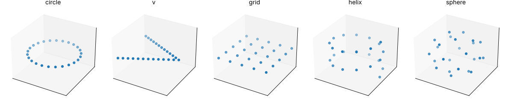

### Demo 1 – Boids flocking
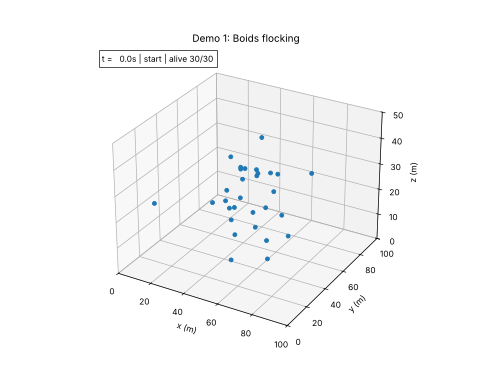
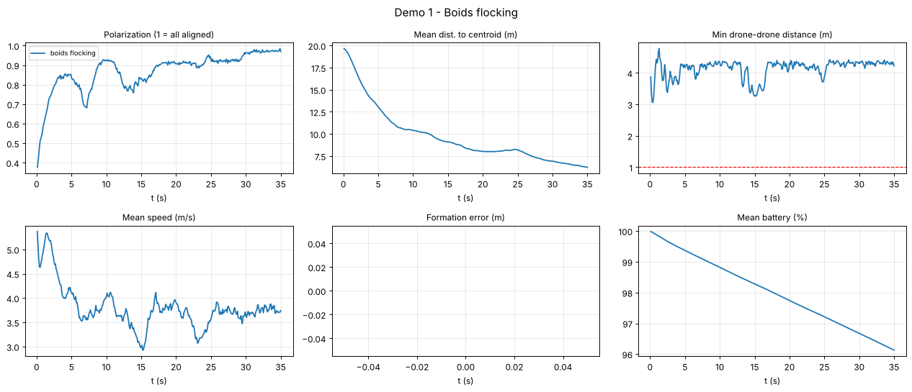

### Demo 2 – Obstacle avoidance
25 drones fly through a city of 7 buildings and reach the goal in **20.5 s** with **0 building collisions** and **0 near-misses**.


### Demo 3 – Formation control + fault tolerance
Grid → circle → sphere → 5 drones fail → re-planned sphere → moving V formation.

| Phase | Min separation (m) | Near-misses | Final formation error (m) |
|---|---|---|---|
| grid | 1.42 | 0 | 0.00 |
| circle | 3.22 | 0 | 0.00 |
| sphere | 2.87 | 0 | 0.00 |
| sphere (5 failed) | 6.49 | 0 | 0.00 |
| V moving | 2.18 | 0 | 3.52 (while moving) |


### Experiment – separation weight vs safety
Without enough separation (w_sep ≤ 0.5) drones collapse onto each other; from **w_sep ≥ 1.0 there are zero near-misses** for 15, 30 and 50 drones.


### Demo 4 – Search & Rescue (PSO)
10 drones find all 5 survivors in a 150 × 150 m area in **74 s**.


### Benchmark – search strategies (8 random worlds each)

| Scenario | Strategy | Success | Time to find all (s) | Mean find time (s) |
|---|---|---|---|---|
| A: 100×100 m, 12 drones | lawnmower | 100% | **33.3 ± 5.7** | 21.1 |
| | pso | 100% | 48.2 ± 8.0 | 30.0 |
| | random | 100% | 42.7 ± 27.2 | 24.4 |
| B: 200×200 m, 10 drones | lawnmower | 100% | 146.0 ± 54.2 | 84.4 |
| | pso | 100% | **89.9 ± 9.5** | 56.8 |
| | random | 100% | 286.4 ± 138.8 | 111.7 |

Lawnmower is best when drones are dense; in a large area with few drones, signal-guided PSO is ~38 % faster than lawnmower and ~3× faster than random search.


### Full mission
Takeoff → flock through the city → circle survey → 4 drones fail → helix → V formation to landing zone.
Mission time **87.7 s**, **0 building collisions**, **0 near-misses**, minimum separation 1.52 m.

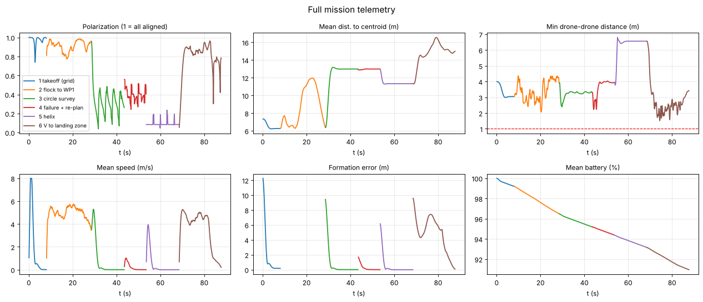

---

## Results – v2 (extensions)

### 1. Quadrotor dynamics, wind and GPS noise
City navigation, 25 drones, 4 random starts each:

| Vehicle / controller | Time (s) | Min separation (m) | Near-misses | Building hits | Battery used (%) |
|---|---|---|---|---|---|
| point mass (v1) | 20.3 | 1.93 | 0 | 0 | 2.69 |
| quadrotor | 21.5 | **0.65** | **8** | 0 | 2.19 |
| quadrotor + wind | 20.9 | 1.34 | 0 | 0 | 2.13 |
| quadrotor + wind + GPS noise 0.5 m | 21.2 | 0.99 | 1 | 0 | 2.15 |
| quadrotor + slower (6.5 m/s) + 5 m separation | 28.4 | 1.87 | **0** | 0 | 2.82 |
| quadrotor + predictive avoidance | 40.5 | 1.90 | **0** | 0 | 4.08 |

**Finding:** gains tuned on a point mass are not safe on a real quadrotor — the attitude lag means drones cannot react instantly, causing near-misses. Slowing down with a larger safety bubble (+40 % time) or predictive avoidance (+100 % time) restores safety; the learned gains in section 7 stay collision-free under quadrotor dynamics + wind while getting faster (tested with 15-drone swarms).


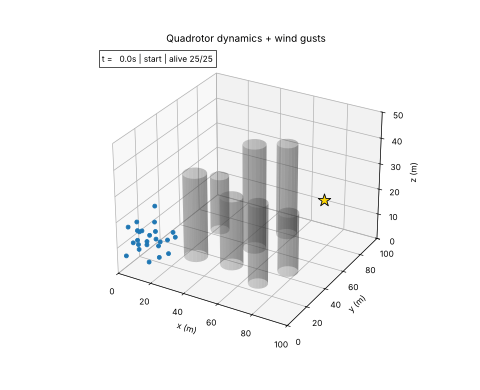

### 2. Communication: packet loss × latency
30 drones flocking, radio range 20 m (collision avoidance uses on-board sensing, so near-misses stay at 0):


Packet loss alone is tolerated well (keeping the last received state works) — up to 60 % loss barely changes alignment. **Latency is the real problem:** at 2 s delay polarization drops from 0.75 to ~0.5 and the flock spreads out (spread 19 m → 33 m); combined with 90 % loss it breaks into 5+ groups.

### 3. Moving obstacles and multiple swarms

| Avoidance | Time (s) | Min clearance (m) | Obstacle hits |
|---|---|---|---|
| none | 19.3 | −2.92 (inside obstacle) | 45 |
| predictive (closest point of approach) | 19.5 | **1.81** | **0** |

Two swarms of 15 drones swapping sides head-on: minimum distance between teams **3.17 m**, **0 near-misses**.


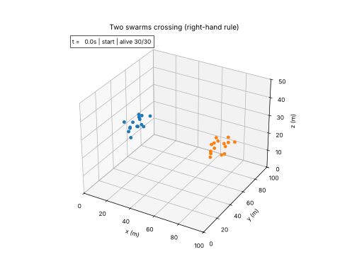

### 4. Coverage control with batteries
Lloyd's algorithm cuts the locational cost from 4632 to **127 (−97 %)**. With batteries, drones go back to the charger (yellow square) below 25 %, the rest re-partition the area; on average **8.6 of 10** drones are covering and no battery drops below **16 %**.

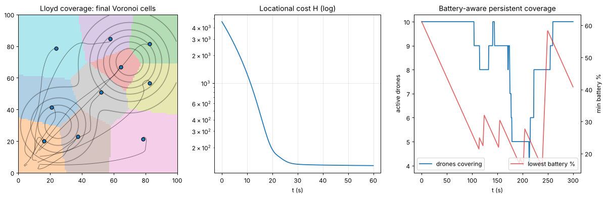
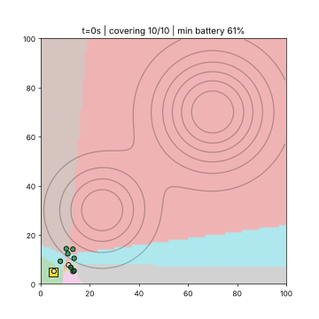

### 5. Consensus
Rendezvous only succeeds when the communication graph is connected (λ₂ > 0): with 15 m or 25 m radio range the drones stay in separate clusters, with 35 m or more they all meet. The same law with offsets builds a circle formation without a central planner, and pinning one leader makes the group follow its path.


### 6. Task allocation (5 drones, 30 inspection points, 10 random maps)

| Method | Makespan (m) | Total distance (m) |
|---|---|---|
| auction | **145.0** | 598.2 |
| greedy nearest | 362.9 | 469.9 |
| random | 247.4 | 978.3 |

The auction finishes the mission **2.5× sooner** than greedy (greedy dumps most tasks on one drone) and uses **39 % less total distance** than random.

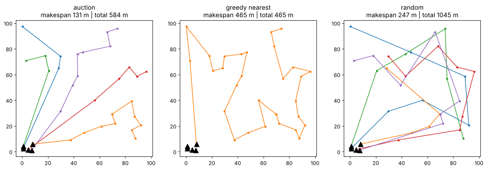

### 7. Learning controller gains (Evolution Strategy)
Trained on 4 worlds with quadrotor dynamics + wind, evaluated on **8 unseen worlds**:

| Controller | Time to goal (s) | Near-misses | Building hits | Min separation (m) | Success |
|---|---|---|---|---|---|
| default (hand-tuned) | 20.09 | 0 | 0 | 1.30 | 100 % |
| learned (ES) | **16.92** | 0 | 0 | **1.77** | 100 % |

The learned controller is **16 % faster and keeps a larger safety margin**. It raises alignment and separation, lowers obstacle repulsion and uses a smaller safety bubble.

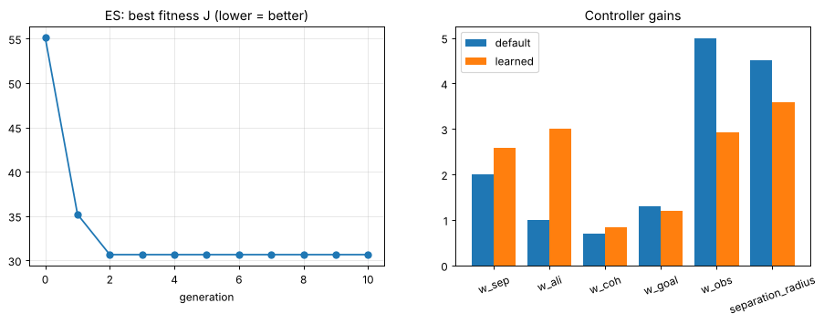

### 8. Real-drone integration
* `drone_swarm.export` – trajectories to CSV, waypoint JSON and one **QGroundControl `.plan`** per drone (`examples/export_mission.py`).
* `integrations/ros2/swarm_controller_node.py` – ROS 2 node: subscribes `/droneN/odom`, publishes `/droneN/cmd_vel`.
* `integrations/px4/mavsdk_swarm_offboard.py` – PX4 multi-vehicle SITL / hardware in OFFBOARD velocity mode via MAVSDK.

The ROS 2 and PX4 scripts are integration templates: they are not run in CI (no ROS / PX4 there). Test them in simulation (Gazebo / PX4 SITL) before flying real hardware.

### 9. Interactive browser playground
`docs/index.html` runs flocking, cursor following, formations, obstacle placement, a "predator" and drone failures live in the browser — open the file directly, or serve it with GitHub Pages.

---

## Results – v3 (deep learning, reinforcement learning & robotics)

All models are small enough to train on a laptop CPU or in Colab; pretrained weights are in `models/`.

### 1. Multi-agent reinforcement learning (MAPPO) + safety shield
**Task:** drones start on a circle and must reach the opposite point through random obstacles — every path crosses the centre.
**Policy:** one shared network per drone; it encodes its own state, attends (multi-head attention) over its 5 nearest drones and 3 nearest obstacles, and outputs an acceleration. The critic also sees a mean-pooled embedding of the whole swarm (centralised training, decentralised execution). 400 PPO updates + 150 fine-tuning updates with an obstacle-aware reward (~25 min on 2 CPU cores).
**Safe RL:** a control-barrier-function QP minimally corrects the policy's command so drone-drone and drone-obstacle distances stay above a margin.

| Drones | Controller | Success | Collision-free episodes | Drone-drone collisions / ep | Obstacle collisions / ep | Time (s) |
|---|---|---|---|---|---|---|
| 8 | Potential field (aggressive) | 81 % | 0 % | 35.0 | 10.5 | 11.4 |
| 8 | Potential field (safe) | 67 % | 75 % | 0.9 | 0.5 | 14.7 |
| 8 | **MAPPO** | **98 %** | 97 % | 0 | 0.13 | **9.3** |
| 8 | **MAPPO + CBF shield** | **98 %** | **100 %** | **0** | **0** | 10.3 |
| 16 (unseen size) | Potential field (aggressive) | 77 % | 0 % | 127 | 19.9 | 12.7 |
| 16 | MAPPO | 98 % | 48 % | 9.4 | 0.25 | 9.4 |
| 16 | MAPPO + CBF shield | 73 % | **100 %** | **0** | **0** | 13.1 |

The learned policy is faster *and* safer than both hand-tuned baselines, which have to choose between speed and safety. With the CBF shield, 8-drone episodes are 100 % collision-free at almost no cost. With twice as many drones as in training the shield still guarantees safety, but some drones get stuck in the crowded centre (73 % success) — training with the shield in the loop is the natural next step.

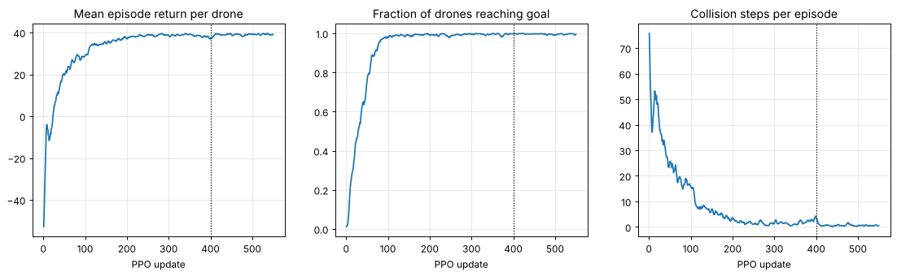
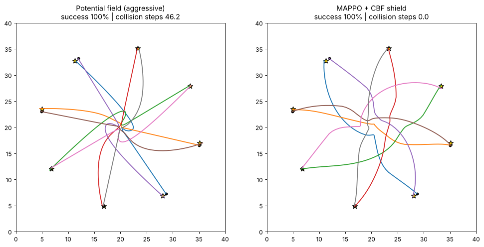
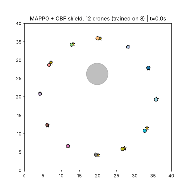

### 2. Graph Neural Network flocking (imitation learning)
A centralised expert aligns everyone's velocity using *global* information. A GNN (3 rounds of learned message passing between radio neighbours) is trained with behaviour cloning + DAgger to imitate it using only *local* communication. Velocity-alignment cost (lower = better), trained on 40 drones:

| Drones | Centralised expert | **GNN (local comms)** | Local controller |
|---|---|---|---|
| 20 | 0.53 | **0.96** | 1.31 |
| 40 | 0.55 | **0.91** | 1.25 |
| 80 | 0.59 | **0.79** | 1.22 |

The GNN closes about half of the gap between the local controller and the centralised expert, and generalises to a swarm twice the training size, where it does even better (−35 % cost vs local).

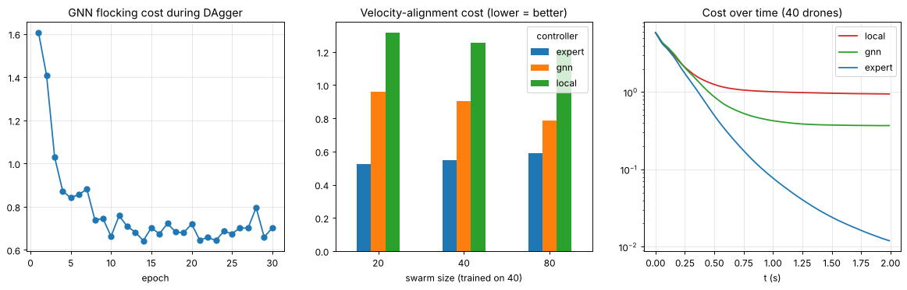

### 3. Deep Q-Network search
A survivor is hidden according to a prior belief map (two random blobs); each step the drone moves and looks (p_detect = 0.8), and the belief is updated with Bayes' rule. Reward = probability of detection, so the return is the probability of success. Double + Dueling DQN on an egocentric belief map, 192 k transitions:

| Policy | P(found) after 20 steps | P(found) after 60 steps |
|---|---|---|
| random walk | 0.016 | 0.065 |
| lawnmower | 0.025 | 0.137 |
| greedy (best neighbour) | 0.182 | 0.524 |
| **DQN** | **0.184** | **0.550** |

DQN learns a policy 4× better than a lawnmower sweep and slightly better than the strong greedy heuristic (+5 %), because it plans which blob to search and when to leave it.

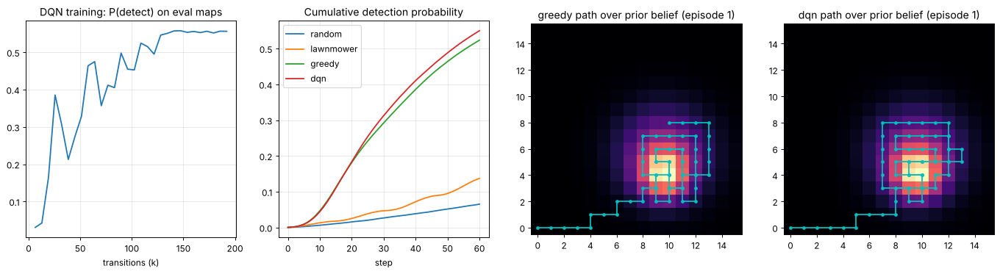

### 4. CNN survivor detection and the altitude trade-off
A procedural renderer creates aerial patches (grass, soil, trees, rocks, colourful debris as hard negatives, people in bright clothing). Higher altitude = smaller person, more blur and noise. A 4-layer CNN trained on 16 k images reaches **ROC AUC 0.969**.

| Altitude (m) | 10 | 20 | 30 | 40 | 50 | 60 | 70 | 80 |
|---|---|---|---|---|---|---|---|---|
| Recall | 0.99 | 1.00 | 1.00 | 0.96 | 0.91 | 0.91 | 0.46 | 0.62 |
| Precision | 1.00 | 1.00 | 0.99 | 0.95 | 0.90 | 0.87 | 0.66 | 0.58 |

Combining recall with the camera footprint (70° field of view), the expected number of detections per minute peaks at **60 m** — flying lower sees people better but covers the area too slowly; flying higher misses them.

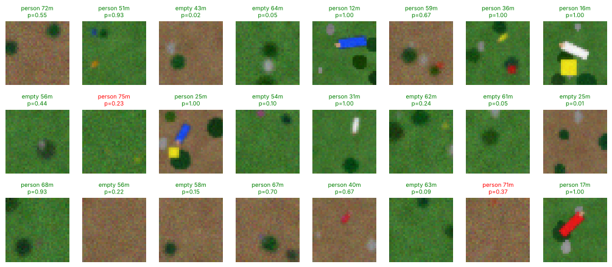
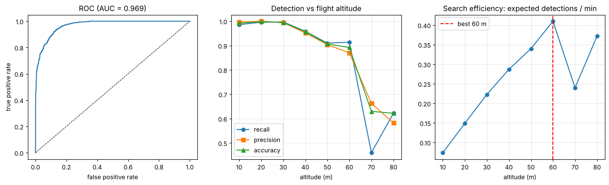

### 5. LSTM / Transformer trajectory prediction
Predict a manoeuvring intruder's next 2 s from the last 1 s:

| Model | ADE (m) | FDE (m) |
|---|---|---|
| constant velocity | 2.32 | 5.88 |
| constant turn rate (physics) | 1.78 | 4.53 |
| **LSTM** | **1.00** | **2.64** |
| **Transformer** | **1.00** | **2.64** |

Both networks halve the error of the physics models (they reach the same accuracy, likely the predictability limit of the random manoeuvres). Plugged into collision avoidance on 400 head-on encounters, loss of separation drops from 98 % (no avoidance) to 4.2 % (constant velocity), 3.8 % (turn-rate model) and **1.2 % (LSTM)**.

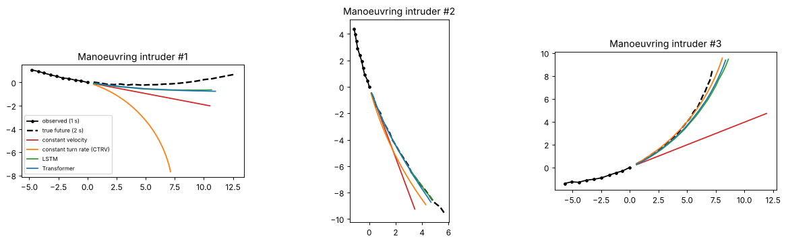

### 6. Autoencoder fault detection
Faults injected into one drone of an 8-drone formation flying in wind; the autoencoder is trained on healthy telemetry only.

| Fault | Autoencoder recall | Delay | z-score rule recall | Delay |
|---|---|---|---|---|
| motor (−55 % thrust) | 0.95 | 0.7 s | 0.96 | 0.5 s |
| GPS drift (0.4 m/s) | **0.81** | **3.1 s** | 0.64 | 6.0 s |
| IMU bias | 1.00 | 0.0 s | 1.00 | 0.0 s |
| false-alarm rate (healthy) | 0.7 % | | 0.4 % | |

Sudden faults are easy for both; the autoencoder's advantage is on the *slow* GPS drift, which it detects twice as fast because it learns the correlations between features over a 2 s window.

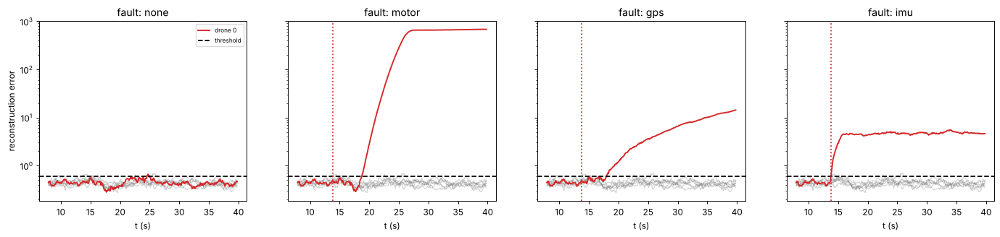

### 7. Learned dynamics + MPPI
An MLP learns the quadrotor's thrust/attitude dynamics from 60 k random transitions (validation error 0.08 m/s²). MPPI (256 sampled action sequences, 2 s horizon) then flies through a pillar field in wind:

| Controller | Crashed | Min clearance | Time |
|---|---|---|---|
| PD (no look-ahead) | 6 / 6 | −1.04 m | 6.0 s |
| **MPPI + learned model** | **0 / 6** | **1.97 m** | 7.6 s |
| MPPI + true model | 0 / 6 | 1.97 m | 7.7 s |

Planning with the learned model is as safe as planning with the true physics. MPPI chooses to go around the pillar field rather than weave through it.

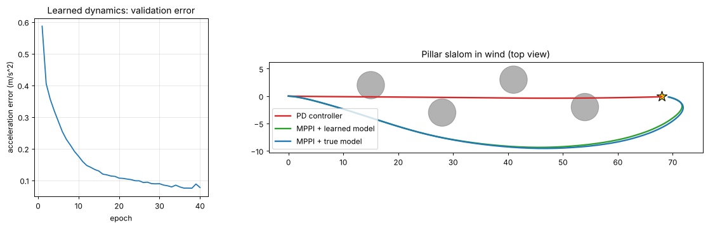

### 8. Classical robotics
| Method | Result |
|---|---|
| **Kalman filter** (100 Hz IMU + 5 Hz GPS, 8 s GPS outage) | position RMSE **1.33 m** vs 9.24 m GPS-only and 430 m IMU-only; accelerometer bias estimated as (0.41, −0.30, 0.20), true (0.4, −0.3, 0.2) |
| **Particle filter** (phone RSSI) | orbiting the current estimate: 1.6 m final error vs 2.3 m for an expanding spiral |
| **A\*** | 97.6 m path in 8 ms (93.9 m after smoothing); straight line hits buildings |
| **RRT\*** | 95.6 m path with 3000 samples |
| **Control barrier functions** | 16 drones swap through the centre: nominal min distance 0.002 m (56 violation steps) → CBF **2.02 m, 0 violations, 100 % arrive** (right-hand rule avoids deadlock) |
| **Occupancy mapping** | 3 drones with lidar map **100 %** of free space with frontier exploration vs 15 % with random walk |

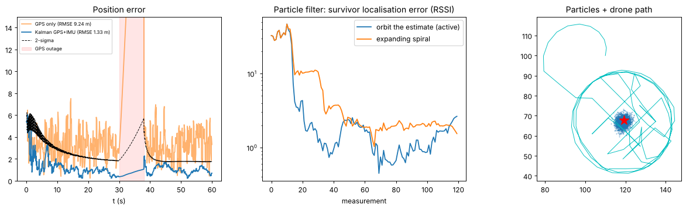
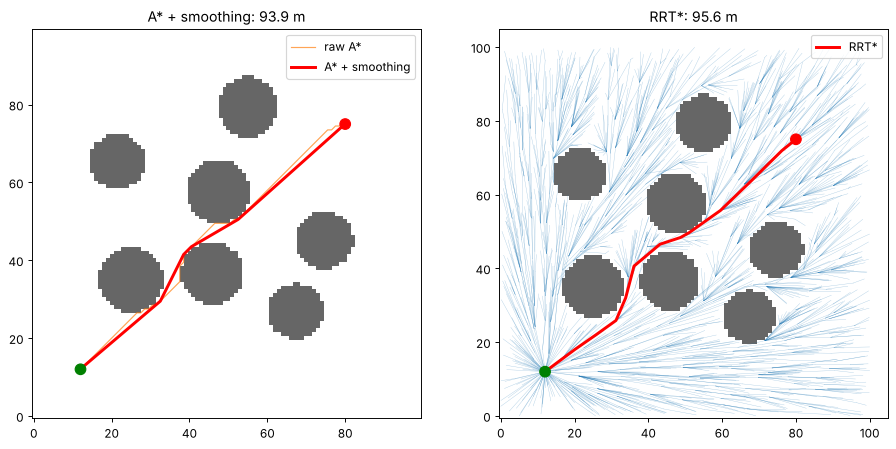
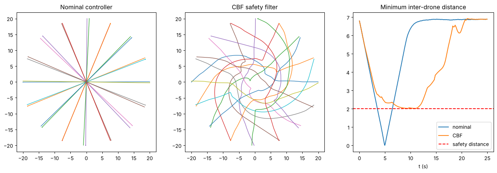
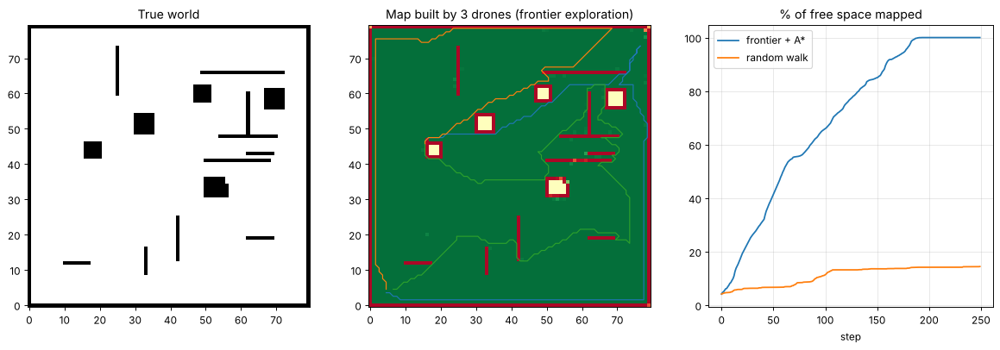

---

## Possible next steps
- Train the MAPPO policy with the CBF shield in the loop (and on larger swarms)
- Full 6-DOF rigid-body model with rotor dynamics
- Gazebo / AirSim worlds with real camera images for the detector
- Hardware tests with Crazyflie or PX4 drones

## Author
**Yuvraj Gupta**
