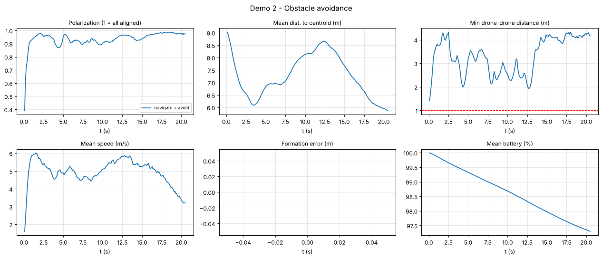
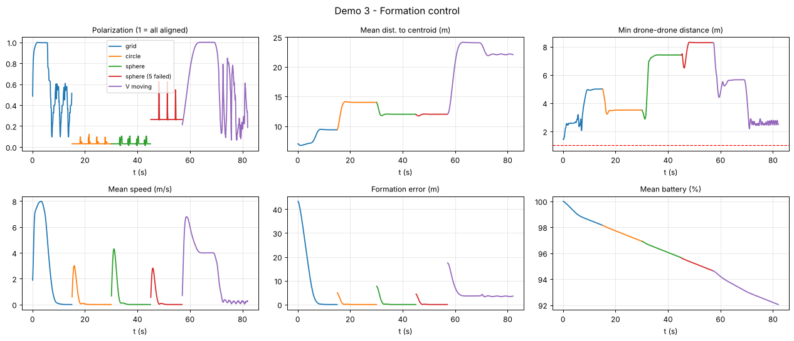
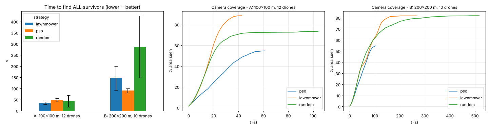
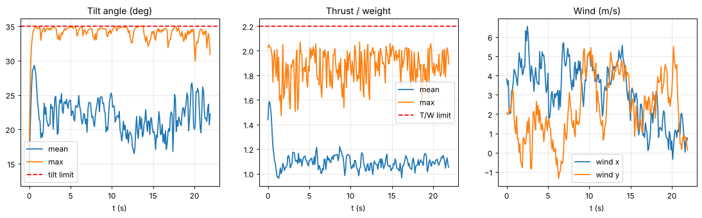
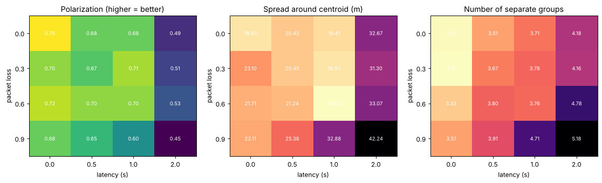
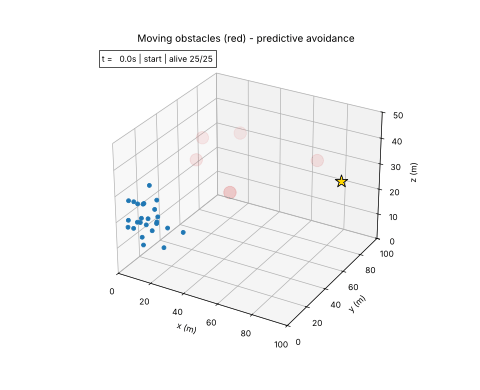
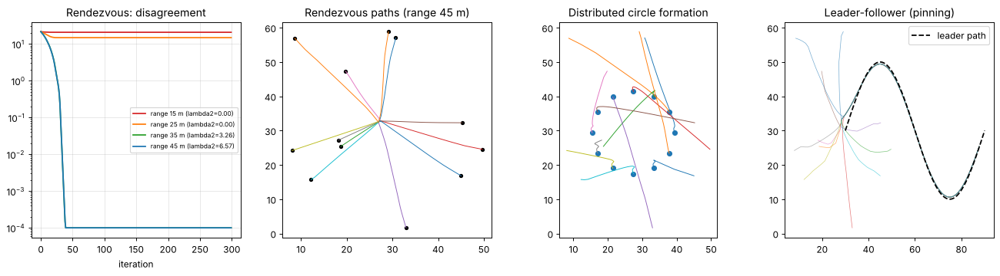

# Drone Swarm Robotics Simulator

[](https://github.com/guptuv/drone-swarm-robotics/actions/workflows/tests.yml)
[](LICENSE)

A Python simulator for multi-drone swarms covering the core problems of swarm robotics:

| Area | What is implemented |
|---|---|
| Collective motion | Boids flocking (separation, alignment, cohesion) |
| Navigation | Goal seeking, static buildings, **moving obstacles** with predictive avoidance |
| Formation control | Circle / V / grid / helix / sphere, Hungarian slot assignment, PD tracking, **fault tolerance** |
| Vehicle model | Point mass **or quadrotor dynamics** (thrust & tilt limits, attitude lag), **wind gusts**, **GPS noise** |
| Networking | **Communication range, packet loss and latency** between drones |
| Multi-swarm | **Several teams sharing the airspace**, reciprocal avoidance with a right-hand rule |
| Search & rescue | PSO with local radio communication vs lawnmower vs random search |
| Coverage | **Voronoi / Lloyd coverage control** with **battery-aware return-to-charge** |
| Distributed control | **Consensus** rendezvous & formation, **leader-follower** |
| Task allocation | **Auction-based** multi-task allocation vs greedy vs random |
| Learning | **Evolution Strategy** that learns controller gains under wind and quadrotor dynamics |
| Real drones | **Export** to CSV / JSON / QGroundControl `.plan`, **ROS 2** node and **PX4 / MAVSDK** templates |
| Web | **Interactive browser playground** (`docs/index.html`) |


| Notebook | Open |
|---|---|
| Core demos (flocking, obstacles, formations, search & rescue, full mission) | [](https://colab.research.google.com/github/guptuv/drone-swarm-robotics/blob/main/notebooks/drone_swarm_simulator.ipynb) |
| v2 extensions (dynamics, comms, multi-swarm, coverage, consensus, auction, learning, export) | [](https://colab.research.google.com/github/guptuv/drone-swarm-robotics/blob/main/notebooks/extensions_demo.ipynb) |

---

## Project structure

```
drone_swarm/                  Python package
  core.py                     SwarmConfig, Building, make_city, vector helpers
  formations.py               formation shapes (circle, v, grid, helix, sphere)
  swarm.py                    DroneSwarm: flocking, avoidance, formations, fault tolerance, telemetry
  dynamics.py                 QuadrotorDynamics (thrust / tilt / attitude lag / power), Wind
  comms.py                    CommModel: range, packet loss, latency
  obstacles.py                MovingObstacle, random_obstacles
  sar.py                      SearchAndRescue: pso / lawnmower / random
  coverage.py                 CoverageSwarm: Lloyd / Voronoi coverage + battery return-to-charge
  consensus.py                consensus rendezvous / formation, leader-follower, algebraic connectivity
  allocation.py               auction, greedy and random task allocation + 2-opt routes
  learning.py                 evolution strategy for controller gains
  export.py                   CSV / JSON / QGroundControl .plan export
  viz.py                      3D animation, telemetry dashboard, search-and-rescue animation
integrations/
  ros2/swarm_controller_node.py   ROS 2 node (odom in, cmd_vel out)
  px4/mavsdk_swarm_offboard.py    PX4 multi-vehicle OFFBOARD control with MAVSDK
notebooks/                    Colab notebooks
scripts/run_all.py            regenerates the v1 results
scripts/run_extensions.py     regenerates the v2 extension results
examples/export_mission.py    simulate a mission and export it for real drones
docs/index.html               interactive browser playground
tests/                        pytest suite (runs on every push via GitHub Actions)
results/                      generated plots, animations and tables
```

## Quick start

```bash
pip install git+https://github.com/guptuv/drone-swarm-robotics.git
# or, from a clone:
pip install -e ".[dev]"
python -m pytest                    # 18 tests
python scripts/run_all.py           # v1 results  (~1-2 min)
python scripts/run_extensions.py    # v2 results  (~2 min)
```

```python
import numpy as np
from drone_swarm import SwarmConfig, DroneSwarm, make_city, QuadrotorDynamics, Wind, CommModel

n = 25
sw = DroneSwarm(SwarmConfig(n_drones=n), start_center=(12, 12, 10))
sw.buildings, sw.goal = make_city(), np.array([80, 75, 20])
sw.dynamics = QuadrotorDynamics(n)                      # optional: realistic vehicle
sw.wind = Wind(mean=(4, 2, 0), gust_std=2.0)            # optional: wind gusts
sw.comms = CommModel(n, range_m=30, p_loss=0.3)         # optional: lossy radio
sw.run(500, phase='navigate')

sw.goal = None
sw.set_formation('circle', center=(80, 75, 20), radius=12)
sw.run(150, phase='circle')
sw.fail_drones(4)                                       # survivors re-assign slots automatically
sw.run(100, phase='after failure')
print(sw.df().groupby('phase').min_separation.min())
```

---

## Methods

| Component | Approach |
|---|---|
| Drone model | 3D point mass (8 m/s, 7 m/s²) or quadrotor: desired acceleration → thrust vector → tilt-limited attitude (35°) with first-order lag (τ = 0.15 s), thrust-to-weight 2.2, drag, power ∝ T^1.5 |
| Wind | Mean wind + Ornstein-Uhlenbeck gusts |
| Flocking | Reynolds steering (desired − current velocity), 15 m neighbourhood, same-team only |
| Static obstacles | Cylinder buildings: radial repulsion + tangential slide |
| Moving obstacles / other drones | Closest-point-of-approach prediction (velocity obstacle), right-hand rule for head-on encounters |
| Formation | Shape offsets → Hungarian assignment → PD controller; V rotates with heading; re-plan after failures |
| Communication | Each drone keeps the last state it received from each neighbour; range limit, Bernoulli packet loss, fixed latency; collision avoidance uses on-board sensing |
| Search & rescue | Noisy Gaussian survivor signal; PSO with neighbours in radio range; frontier exploration when silent |
| Coverage | Lloyd's algorithm on an importance density; drones below 25 % battery return to the charger and the rest re-partition |
| Consensus | x ← x − ε L(x − d) on the proximity graph; convergence needs λ₂(L) > 0 |
| Task allocation | Sequential auction: each drone bids the marginal cost of inserting a task into its route (+ load balancing), then 2-opt |
| Learning | (μ, λ) Evolution Strategy over 6 gains, fitness = time + safety penalties, trained on 4 worlds and tested on 8 unseen worlds |

---

## Results – v1 (core)

### Formation shapes


### Demo 1 – Boids flocking


### Demo 2 – Obstacle avoidance
25 drones fly through a city of 7 buildings and reach the goal in **20.5 s** with **0 building collisions** and **0 near-misses**.




### Demo 3 – Formation control + fault tolerance
Grid → circle → sphere → 5 drones fail → re-planned sphere → moving V formation.

| Phase | Min separation (m) | Near-misses | Final formation error (m) |
|---|---|---|---|
| grid | 1.42 | 0 | 0.00 |
| circle | 3.22 | 0 | 0.00 |
| sphere | 2.87 | 0 | 0.00 |
| sphere (5 failed) | 6.49 | 0 | 0.00 |
| V moving | 2.18 | 0 | 3.52 (while moving) |




### Experiment – separation weight vs safety
Without enough separation (w_sep ≤ 0.5) drones collapse onto each other; from **w_sep ≥ 1.0 there are zero near-misses** for 15, 30 and 50 drones.


### Demo 4 – Search & Rescue (PSO)
10 drones find all 5 survivors in a 150 × 150 m area in **74 s**.


### Benchmark – search strategies (8 random worlds each)

| Scenario | Strategy | Success | Time to find all (s) | Mean find time (s) |
|---|---|---|---|---|
| A: 100×100 m, 12 drones | lawnmower | 100% | **33.3 ± 5.7** | 21.1 |
| | pso | 100% | 48.2 ± 8.0 | 30.0 |
| | random | 100% | 42.7 ± 27.2 | 24.4 |
| B: 200×200 m, 10 drones | lawnmower | 100% | 146.0 ± 54.2 | 84.4 |
| | pso | 100% | **89.9 ± 9.5** | 56.8 |
| | random | 100% | 286.4 ± 138.8 | 111.7 |

Lawnmower is best when drones are dense; in a large area with few drones, signal-guided PSO is ~38 % faster than lawnmower and ~3× faster than random search.



### Full mission
Takeoff → flock through the city → circle survey → 4 drones fail → helix → V formation to landing zone.
Mission time **87.7 s**, **0 building collisions**, **0 near-misses**, minimum separation 1.52 m.


---

## Results – v2 (extensions)

### 1. Quadrotor dynamics, wind and GPS noise
City navigation, 25 drones, 4 random starts each:

| Vehicle / controller | Time (s) | Min separation (m) | Near-misses | Building hits | Battery used (%) |
|---|---|---|---|---|---|
| point mass (v1) | 20.3 | 1.93 | 0 | 0 | 2.69 |
| quadrotor | 21.5 | **0.65** | **8** | 0 | 2.19 |
| quadrotor + wind | 20.9 | 1.34 | 0 | 0 | 2.13 |
| quadrotor + wind + GPS noise 0.5 m | 21.2 | 0.99 | 1 | 0 | 2.15 |
| quadrotor + slower (6.5 m/s) + 5 m separation | 28.4 | 1.87 | **0** | 0 | 2.82 |
| quadrotor + predictive avoidance | 40.5 | 1.90 | **0** | 0 | 4.08 |

**Finding:** gains tuned on a point mass are not safe on a real quadrotor — the attitude lag means drones cannot react instantly, causing near-misses. Slowing down with a larger safety bubble (+40 % time) or predictive avoidance (+100 % time) restores safety; the learned gains in section 7 stay collision-free under quadrotor dynamics + wind while getting faster (tested with 15-drone swarms).




### 2. Communication: packet loss × latency
30 drones flocking, radio range 20 m (collision avoidance uses on-board sensing, so near-misses stay at 0):



Packet loss alone is tolerated well (keeping the last received state works) — up to 60 % loss barely changes alignment. **Latency is the real problem:** at 2 s delay polarization drops from 0.75 to ~0.5 and the flock spreads out (spread 19 m → 33 m); combined with 90 % loss it breaks into 5+ groups.

### 3. Moving obstacles and multiple swarms

| Avoidance | Time (s) | Min clearance (m) | Obstacle hits |
|---|---|---|---|
| none | 19.3 | −2.92 (inside obstacle) | 45 |
| predictive (closest point of approach) | 19.5 | **1.81** | **0** |

Two swarms of 15 drones swapping sides head-on: minimum distance between teams **3.17 m**, **0 near-misses**.




### 4. Coverage control with batteries
Lloyd's algorithm cuts the locational cost from 4632 to **127 (−97 %)**. With batteries, drones go back to the charger (yellow square) below 25 %, the rest re-partition the area; on average **8.6 of 10** drones are covering and no battery drops below **16 %**.


### 5. Consensus
Rendezvous only succeeds when the communication graph is connected (λ₂ > 0): with 15 m or 25 m radio range the drones stay in separate clusters, with 35 m or more they all meet. The same law with offsets builds a circle formation without a central planner, and pinning one leader makes the group follow its path.



### 6. Task allocation (5 drones, 30 inspection points, 10 random maps)

| Method | Makespan (m) | Total distance (m) |
|---|---|---|
| auction | **145.0** | 598.2 |
| greedy nearest | 362.9 | 469.9 |
| random | 247.4 | 978.3 |

The auction finishes the mission **2.5× sooner** than greedy (greedy dumps most tasks on one drone) and uses **39 % less total distance** than random.


### 7. Learning controller gains (Evolution Strategy)
Trained on 4 worlds with quadrotor dynamics + wind, evaluated on **8 unseen worlds**:

| Controller | Time to goal (s) | Near-misses | Building hits | Min separation (m) | Success |
|---|---|---|---|---|---|
| default (hand-tuned) | 20.09 | 0 | 0 | 1.30 | 100 % |
| learned (ES) | **16.92** | 0 | 0 | **1.77** | 100 % |

The learned controller is **16 % faster and keeps a larger safety margin**. It raises alignment and separation, lowers obstacle repulsion and uses a smaller safety bubble.


### 8. Real-drone integration
* `drone_swarm.export` – trajectories to CSV, waypoint JSON and one **QGroundControl `.plan`** per drone (`examples/export_mission.py`).
* `integrations/ros2/swarm_controller_node.py` – ROS 2 node: subscribes `/droneN/odom`, publishes `/droneN/cmd_vel`.
* `integrations/px4/mavsdk_swarm_offboard.py` – PX4 multi-vehicle SITL / hardware in OFFBOARD velocity mode via MAVSDK.

The ROS 2 and PX4 scripts are integration templates: they are not run in CI (no ROS / PX4 there). Test them in simulation (Gazebo / PX4 SITL) before flying real hardware.

### 9. Interactive browser playground
`docs/index.html` runs flocking, cursor following, formations, obstacle placement, a "predator" and drone failures live in the browser — open the file directly, or serve it with GitHub Pages.

---

## Possible next steps
- Full 6-DOF rigid-body model with rotor dynamics
- Reinforcement learning (PPO / MAPPO) policies
- Gazebo / AirSim worlds with camera-based detection
- Hardware tests with Crazyflie or PX4 drones

## Author
**Yuvraj Gupta**
