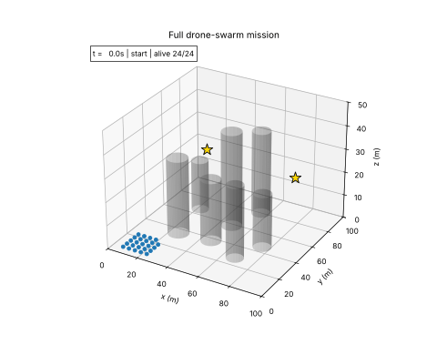
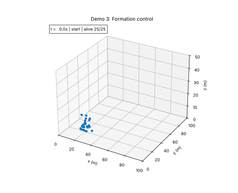
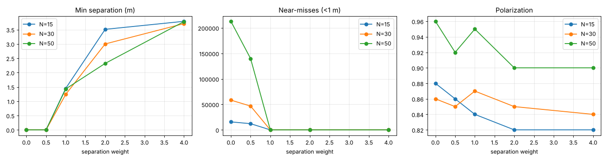
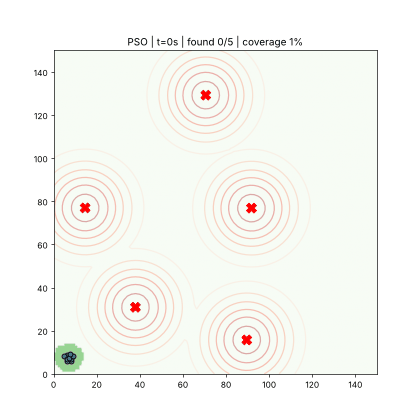

# Drone Swarm Robotics Simulator

A Python simulator for multi-drone swarms covering four core swarm-robotics problems:

1. **Boids flocking** – separation, alignment and cohesion (Reynolds 1987)
2. **Obstacle avoidance + goal seeking** – potential fields with tangential sliding around buildings
3. **Formation control** – circle / V / grid / helix / sphere shapes, optimal slot assignment with the Hungarian algorithm, PD tracking and automatic re-planning when drones fail
4. **Search & Rescue** – Particle Swarm Optimization (PSO) with local radio communication, benchmarked against lawnmower and random search



[](https://colab.research.google.com/github/guptuv/drone-swarm-robotics/blob/main/notebooks/drone_swarm_simulator.ipynb)

---

## Project structure

```
drone_swarm/                 Python package
  core.py                    SwarmConfig, Building, make_city, vector helpers
  formations.py              formation shapes (circle, v, grid, helix, sphere)
  swarm.py                   DroneSwarm: flocking, avoidance, formation, fault tolerance, telemetry
  sar.py                     SearchAndRescue: pso / lawnmower / random strategies
  viz.py                     3D animation, telemetry dashboard, search-and-rescue animation
notebooks/
  drone_swarm_simulator.ipynb  self-contained Colab notebook with all demos
scripts/
  run_all.py                 regenerates every plot, GIF and CSV in results/
results/                     generated plots, animations and tables
```

## Quick start

```bash
pip install -r requirements.txt
python scripts/run_all.py          # ~1-2 minutes, writes everything to results/
```

```python
import numpy as np
from drone_swarm import SwarmConfig, DroneSwarm, make_city

sw = DroneSwarm(SwarmConfig(n_drones=25), start_center=(12, 12, 10))
sw.buildings, sw.goal = make_city(), np.array([80, 75, 20])
sw.run(500, phase='navigate')                  # Boids + goal + obstacle avoidance

sw.goal = None
sw.set_formation('circle', center=(80, 75, 20), radius=12)
sw.run(150, phase='circle')
sw.fail_drones(4)                               # survivors re-assign slots automatically
sw.run(100, phase='after failure')
print(sw.df().groupby('phase').min_separation.min())
```

---

## Methods

| Component | Approach |
|---|---|
| Drone model | 3D point mass, speed limit 8 m/s, acceleration limit 7 m/s², battery drain ∝ speed² |
| Flocking | Reynolds steering (desired velocity − current velocity) for separation, alignment and cohesion within a 15 m neighbourhood |
| Obstacles | Vertical cylinders (buildings); radial repulsion plus a tangential term so drones slide around instead of getting stuck |
| Formation | Shape offsets → Hungarian assignment (minimum total travel) → PD controller; V formation rotates with the heading |
| Fault tolerance | Failed drones make an emergency landing; remaining drones are re-assigned to a smaller formation |
| Search & Rescue | Survivors emit a noisy Gaussian signal. PSO drones share their best reading only with drones in radio range (25 m); when nothing is heard they explore unvisited frontier cells |

Telemetry recorded every step: polarization (velocity alignment), cohesion, minimum separation, near-misses (< 1 m), mean speed, battery and formation error.

---

## Results

### Formation shapes


### Demo 1 – Boids flocking


### Demo 2 – Obstacle avoidance
25 drones fly through a city of 7 buildings and reach the goal in **20.5 s** with **0 building collisions** and **0 near-misses**.


### Demo 3 – Formation control + fault tolerance
Grid → circle → sphere → 5 drones fail → re-planned sphere → moving V formation.

| Phase | Min separation (m) | Near-misses | Final formation error (m) |
|---|---|---|---|
| grid | 1.42 | 0 | 0.00 |
| circle | 3.22 | 0 | 0.00 |
| sphere | 2.87 | 0 | 0.00 |
| sphere (5 failed) | 6.49 | 0 | 0.00 |
| V moving | 2.18 | 0 | 3.52 (while moving) |




### Experiment – separation weight vs safety
Without enough separation (w_sep ≤ 0.5) drones collapse onto each other; from **w_sep ≥ 1.0 there are zero near-misses** for 15, 30 and 50 drones.



### Demo 4 – Search & Rescue (PSO)
10 drones find all 5 survivors in a 150 × 150 m area in **74 s**.



### Benchmark – search strategies (8 random worlds each)

| Scenario | Strategy | Success | Time to find all (s) | Mean find time (s) |
|---|---|---|---|---|
| A: 100×100 m, 12 drones | lawnmower | 100% | **33.3 ± 5.7** | 21.1 |
| | pso | 100% | 48.2 ± 8.0 | 30.0 |
| | random | 100% | 42.7 ± 27.2 | 24.4 |
| B: 200×200 m, 10 drones | lawnmower | 100% | 146.0 ± 54.2 | 84.4 |
| | pso | 100% | **89.9 ± 9.5** | 56.8 |
| | random | 100% | 286.4 ± 138.8 | 111.7 |

**Insight:** a systematic lawnmower sweep is best when drones are dense relative to the area. When the area is large and drones are few, signal-guided PSO finds everyone ~38% faster than lawnmower and ~3× faster than random search, with much lower variance.


### Full mission
Takeoff → flock through the city → circle survey → 4 drones fail → helix → V formation to landing zone.
Mission time **87.7 s**, **0 building collisions**, **0 near-misses**, minimum separation 1.52 m.


---

## Possible extensions
- Full quadrotor dynamics (attitude, thrust) instead of a point mass
- Communication delay / packet loss between drones
- Moving obstacles and other swarms
- ROS 2 / Gazebo or PX4 SITL integration
- Reinforcement-learning controllers

## Author
**Yuvraj Gupta**
